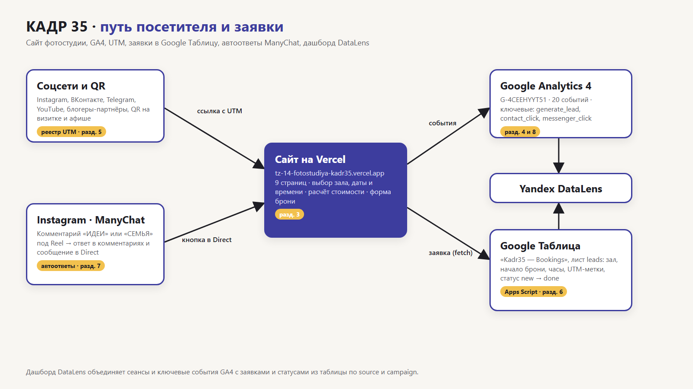

# Фотостудия «Кадр 35» — сайт бронирования залов и сквозная аналитика заявок

Курсовая работа по дисциплине ОП.03 «Информационные технологии», ТЗ № ТЗ-14/2026.
Исполнитель: ___, группа ___.

Сайт к открытию бронирования «Новогоднего зала»: посетитель выбирает зал, дату и время и сразу видит стоимость с утренней скидкой. Каждый переход размечен UTM-меткой, каждая бронь попадает в Google Таблицу вместе с источником, а на дашборде DataLens видно, какой канал приводит брони.



## Ссылки

| Что | Ссылка |
|---|---|
| Сайт | https://tz-14-fotostudiya-kadr35.vercel.app |
| Таблица заявок | https://docs.google.com/spreadsheets/d/1Bzp6WCqNPrF_MocAPSfABBoY0GPIYJEJKyGO_6qOMcc/edit |
| Дашборд DataLens | _этап 5_ |
| Instagram и Reel с автоответом | _этап 4_ |
| ВКонтакте · Telegram · YouTube | _этап 4_ |
| Описание работы | [docs/opisanie.md](docs/opisanie.md) |
| Презентация к защите | [presentation/zashchita.pdf](presentation/zashchita.pdf) |

Ресурс GA4: `G-4CEEHYYT51` («КАДР 35 — сайт», поток «КАДР 35 — Vercel»). Доступ Viewer к ресурсу GA4 выдан: ___ (e-mail Заказчика).

## Что сделано

| Часть | Результат |
|---|---|
| Сайт | 9 страниц и 404, статический HTML/CSS/JS без сборки, Vercel с автодеплоем из `main`, Lighthouse (мобильный): Performance 83 / Accessibility 100 / SEO 100 |
| GA4 | 20 событий (6 автоматических, 14 своих), 7 пользовательских параметров, ключевые: `generate_lead`, `contact_click`, `messenger_click` |
| UTM | 12 ссылок в реестре (лист `utm`, `docs/utm.csv`, полная ссылка — формулой СЦЕПИТЬ), QR-код `docs/qr-u-12.png` на афише `docs/afisha.pdf`; публикации — _этап 4_ |
| Заявки | форма → Apps Script → лист `leads`: проверка полей, защита от повторов по `request_id`, статус брони `new → confirmed → prepaid → done / cancelled` |
| Instagram | ManyChat, две ветки: `ИДЕИ` и `СЕМЬЯ` — _этап 4_ |
| Отчёты | Reports, Explore, воронка, путь, дашборд DataLens — _этап 5_ |

## Технологии

HTML, CSS, JavaScript · Google Analytics 4 · Google Таблицы и Apps Script · ManyChat · Yandex DataLens · GitHub и Vercel. Сайт создан с помощью Claude Code (модель Claude Opus 5.5), запросы — в [docs/prompts.md](docs/prompts.md).

## Структура

```text
index.html halls.html equipment.html photographers.html ideas.html contacts.html thanks.html privacy.html 404.html
css/style.css        стили (фирменные цвета и шрифты — раздел 2 ТЗ)
js/analytics.js      все события GA4
js/form.js           UTM в sessionStorage, проверка и отправка формы брони
js/booking.js        выбор зала, даты, времени и часов, расчёт итога
js/main.js           меню, галерея, калькулятор, фильтр фотографов, промокод
img/  files/         фото (WebP ≤ 300 КБ), картинки Open Graph, схемы залов PDF
apps-script/Code.gs  приёмник заявок (на основе приёмника из темы 7)
docs/                описание, схема, запросы, события, реестр UTM, записка, источники фото
screens/             кадры-доказательства по разделам ТЗ (чек-лист — screens/README.md)
presentation/        презентация к защите
```

Сайт открывается без сборки: `index.html` в браузере или `python -m http.server 8000`. Vercel публикует его после каждого `git push` в `main`.

## Итог

Не получилось: ___

Нейросеть использовалась для: генерации кода всех страниц, стилей и скриптов, приёмника Apps Script, схем залов и схемы работы, подбора фото на Pexels, текстов сайта по сведениям из раздела 2 ТЗ, черновиков документов в `docs/`, а также для настройки GA4, таблицы и Vercel через браузер под аккаунтом Исполнителя. Подробно — в [docs/prompts.md](docs/prompts.md).
