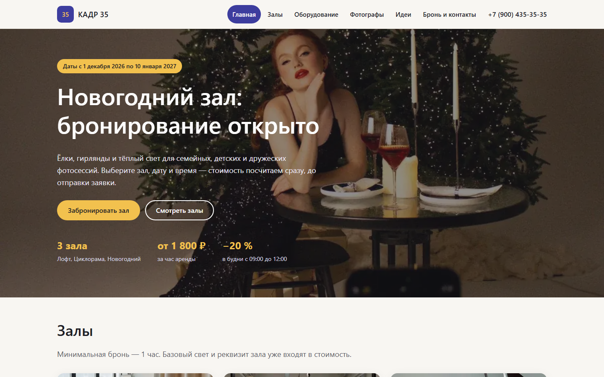
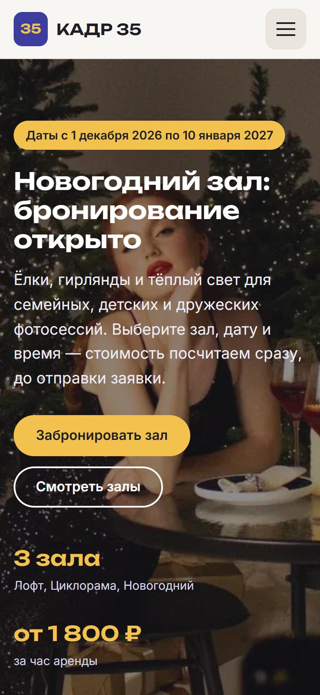
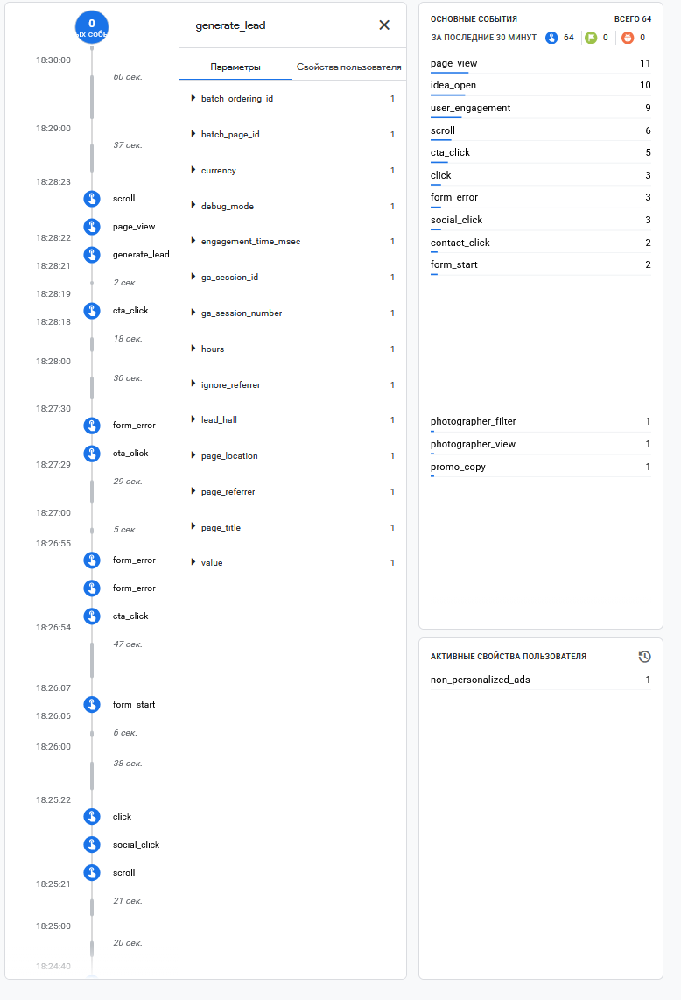
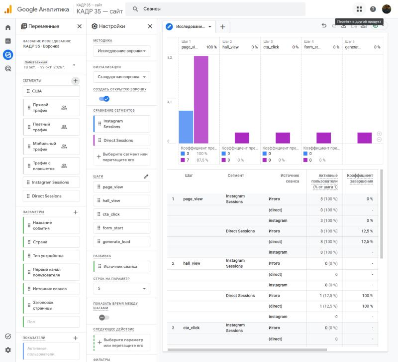

# Описание работы · ТЗ № ТЗ-14/2026 · «Кадр 35»

**Исполнитель:** ___, группа ___
**Сайт:** https://tz-14-fotostudiya-kadr35.vercel.app
**Период проверок:** ___ — ___

## 1. Задача заказчика

Фотостудия «Кадр 35» сдаёт три зала: «Лофт», «Циклорама» и сезонный «Новогодний зал». Брони ведутся вручную в Google Календаре администратора, а заявки приходят в Instagram, Telegram и по телефону. В сентябре 2026 года было 2 двойные брони одного зала и около 60 вопросов о свободном времени, на которые ответили позже чем через час. На продвижение уходит 30 000 ₽ в месяц, но студия не знает, какой канал приводит брони, а в декабре 2025 года Новогодний зал был занят на 94 % часов.

Задача — к 1 ноября 2026 года сделать сайт с выбором свободного времени и расчётом стоимости, где у каждого посетителя виден источник, а все брони собираются в одну таблицу со статусом.

## 2. Схема работы

Посетитель приходит из соцсетей, от блогеров или по QR-коду по ссылке с UTM-метками либо получает ссылку в Direct от ManyChat. Сайт отправляет события в GA4, а бронь — в Google Таблицу через Apps Script. Данные GA4 и таблицы собираются на дашборде DataLens.

## 3. Сайт

Сайт из 9 страниц и страницы 404 создан с помощью Claude Code (Claude Opus 5.5): HTML, CSS и JavaScript без сборки. Страница «Бронь и контакты» показывает свободные часы на 14 дней вперёд, не даёт выбрать время, если хотя бы один час брони занят, и считает итог с утренней скидкой 20 % в будни с 09:00 до 12:00. Например, «Циклорама», будний день, 10:00, 2 часа — 3 520 ₽. «Новогодний зал» доступен только с 1 декабря 2026 по 10 января 2027 года.
Сайт опубликован на Vercel и обновляется после каждого push в `main`.

## 4. Аналитика GA4

Ресурс «КАДР 35 — сайт» (`G-4CEEHYYT51`), часовой пояс Москва, валюта — рубль. Настроено 20 событий, из них своих — 14; все вызовы `gtag('event')` собраны в `js/analytics.js`, кнопки описаны атрибутами `data-event`. Зарегистрировано 7 пользовательских параметров. Ключевые события: `generate_lead`, `contact_click`, `messenger_click`. Каждое событие проверено в DebugView.

## 5. UTM-ссылки и соцсети

В реестре ___ ссылок, опубликованы в ___ (Instagram, ВКонтакте, Telegram, YouTube), у двух партнёров и на афише с QR-кодом.

## 6. Заявки

Форма отправляет бронь через `fetch` в Apps Script. Приёмник построен на основе приёмника из темы 7: проверяет имя, телефон (+7 и 10 цифр), e-mail, зал, время и число часов и записывает строку в лист `leads` вместе с метками `utm_source`, `utm_medium`, `utm_campaign`, `utm_content`. Повторная отправка с тем же `request_id` не создаёт дубль. Событие `generate_lead` уходит в GA4 только после ответа `{"ok": true}`. Администратор ведёт статус брони прямо в таблице: `new → confirmed → prepaid → done` или `cancelled`.

## 7. Автоответы в Instagram

Комментарий «ИДЕИ» под Reel «Новогодний зал: как снимали этот кадр» запускает ответ в комментариях и сообщение в Direct с кнопкой «Смотреть идеи» на `ideas.html`. Вторая ветка — слово «СЕМЬЯ», кнопка ведёт на семейных фотографов.

## 8. Отчёты и дашборд

Воронка показала наибольшую потерю между ___ и ___ (___ %).
Больше всего броней принёс канал ___.

## 9. Что получил бизнес

| Было | Стало |
|---|---|
| брони в календаре администратора, свободные часы сверяются вручную | на сайте видны свободные часы, занятое время выбрать нельзя |
| вопросы о цене и времени ждут ответа больше часа | итог с утренней скидкой виден до отправки заявки |
| заявки в Instagram, Telegram и по телефону | все брони в одной таблице со статусом |
| 30 000 ₽ в месяц на продвижение без понимания отдачи | у каждой брони есть source, medium, campaign; на дашборде — брони по каналам |
| ответы на комментарии вручную | ManyChat отвечает сразу и ведёт на сайт |

Рекомендация заказчику: ___ (по данным из раздела 8).

## 10. Итог

Не получилось: ___
ИИ использовался для: кода сайта и Apps Script, текстов по сведениям из ТЗ, схем, черновиков документов; подробно — в [prompts.md](prompts.md).
